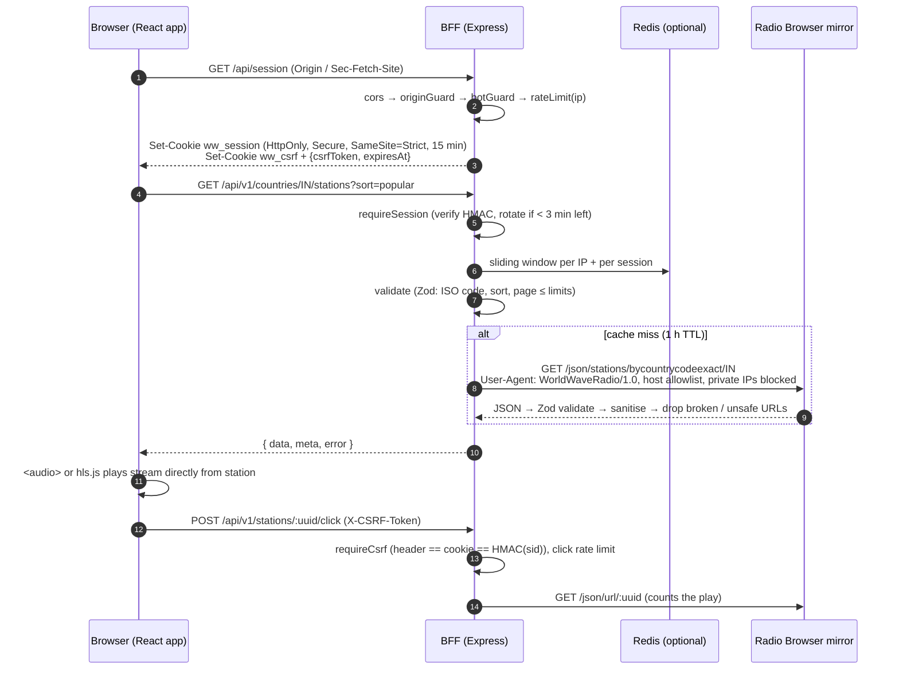

# WorldWave Radio

Browse and listen to live radio stations from every country in the world. React + TypeScript client, hardened Node.js Backend-for-Frontend (BFF), station data from the open [Radio Browser](https://www.radio-browser.info/) API.

[](https://codespaces.new/MANISH50/radio-webapp?quickstart=1)

## Try it from GitHub

Click **Open in GitHub Codespaces** above (or **Code → Codespaces → Create codespace** on the repo page). The codespace installs dependencies, builds the app, starts the server and opens the app in your browser on a private `*.app.github.dev` URL. Nothing to install locally. Codespaces uses your GitHub account's free monthly quota.

Why not GitHub Pages? Pages serves static files only, so it cannot run the BFF. Every security requirement here (session tokens, CSRF, rate limiting, origin checks, the SSRF guard, the rule that the browser never calls third-party APIs) lives in that server. A Pages build would have to call Radio Browser straight from the browser, which this spec forbids. For a permanent public URL, deploy the Docker image to any container host (see [Deploy](#deploy)).

## Architecture

- **`client/`** (React 19, Vite, Tailwind 4, hls.js). It talks only to its own origin (`/api/...`). Hash routes: `#/`, `#/country/IN`, `#/search/<q>`, `#/favourites`, `#/recent`. Favourites, recently played, theme and volume live in `localStorage`, wrapped in try/catch and re-validated on read.
- **`server/`** (Express 5, Zod, pino, helmet). Serves the built client and the `/api` endpoints. All upstream traffic goes through an SSRF-guarded HTTP client to allowlisted Radio Browser mirrors. Countries are cached 24 h and station lists 1 h (in-memory LRU), and concurrent misses are collapsed into one upstream call.
- **Redis** (optional) holds the sliding-window rate-limit counters shared across instances. Without it, or if it fails, counters fall back to process memory.



### API (all responses are `{ data, meta, error }`)

| Method | Path | Notes |
|---|---|---|
| GET | `/api/session` | Issues or rotates the session cookie and returns `csrfToken`. Origin-checked and rate-limited. |
| GET | `/api/v1/health` | Liveness: `{"status":"ok"}`, nothing else. |
| GET | `/api/v1/countries` | Code, name, continent, station count. |
| GET | `/api/v1/countries/:code/stations` | `tag, lang, codec, minBitrate, httpsOnly, sort=popular\|votes\|name\|bitrate, page, limit≤100`. `meta` includes `total`, `totalPages` and `facets` for the filter dropdowns. |
| GET | `/api/v1/stations/search` | `q` (2–100 chars), `page`, `limit≤100`. `meta.hasMore`. |
| POST | `/api/v1/stations/:uuid/click` | Needs `X-CSRF-Token`. Reports a play upstream. |

## Running locally

Requires Node 22+. Redis and Docker are optional.

```bash
npm run install:all
```

```bash
cp .env.example .env
```

For development, run the server and the Vite dev server in two terminals, then open http://localhost:5173 (Vite proxies `/api` to the server on :8080):

```bash
npm run dev:server
```

```bash
npm run dev:client
```

To build and serve everything from the server on http://localhost:8080:

```bash
npm run build && npm start
```

### Tests

Unit and integration tests (Vitest + Supertest):

```bash
npm test
```

Include the Redis sliding-window tests:

```bash
TEST_REDIS_URL=redis://127.0.0.1:6379 npm test
```

End-to-end (Playwright: pick India, play the first station, check "Now playing"). It runs the production build against a local mock of the Radio Browser API (`e2e/mock-upstream.mjs`), so it is deterministic and does not hit the public API:

```bash
npm run test:e2e
```

Dependency audit (all three packages; dependencies pinned to exact versions with lockfiles):

```bash
npm run audit
```

## Deploy

```bash
cp .env.example .env
```

Set `SESSION_SECRET` and `ALLOWED_ORIGINS`, then:

```bash
docker compose up -d --build
```

The image is multi-stage, runs as the non-root `node` user, and keeps app files root-owned and read-only. Compose runs the app with `read_only`, `cap_drop: ALL` and `no-new-privileges`, and does not publish Redis. Put a TLS-terminating reverse proxy in front and set `TRUST_PROXY` to its hop count so client IPs and `req.secure` are correct.

## Environment variables

See [`.env.example`](.env.example) for the full annotated list. The important ones:

| Variable | Default | Purpose |
|---|---|---|
| `NODE_ENV` | `development` | `production` enables HSTS and the HTTPS redirect, and requires `SESSION_SECRET`. |
| `ALLOWED_ORIGINS` | `http://localhost:5173,http://localhost:8080` | Exact origins allowed to call `/api`. The first `https:` entry is the redirect target. |
| `SESSION_SECRET` | random per process (dev only) | HMAC key for session and CSRF tokens, ≥ 32 chars. |
| `TRUST_PROXY` | `0` | Reverse-proxy hops. |
| `REDIS_URL` | unset | Shared rate-limit store. |
| `RB_MIRRORS` | discovered | Fixed mirror list; still filtered through the allowlist. |
| `UPSTREAM_ALLOWED_HOSTS` | `.api.radio-browser.info` | Only hosts the backend may call. |
| `INCLUDE_HTTP_STREAMS` | `false` in production | See "Mixed content". |
| `RATE_*_PER_MIN` | 60 / 120 / 10 / 20 / 20 | Read per session, read per IP, click per session, click per IP, session per IP. |

## Mixed content

On an HTTPS page, browsers block (or try to upgrade, then block) plain-`http://` audio and images. Many radio stations still stream only over HTTP.

- **Production default (`INCLUDE_HTTP_STREAMS=false`):** the server drops HTTP-only stations and HTTP logos. CSP allows only `https:` for media, images and connections, and adds `upgrade-insecure-requests`. Everything listed will play.
- **`INCLUDE_HTTP_STREAMS=true`:** HTTP-only stations are returned with an **"HTTP only"** badge. CSP allows `http:` media. On HTTPS pages the client turns the "HTTPS only" filter on by default, and if a user plays an HTTP stream anyway, it explains that the browser blocks it instead of failing silently. This mode suits local or HTTP-only deployments.
- Proxying HTTP streams through the backend to upgrade them was deliberately not done. It would turn the server into an open audio relay: a large SSRF surface, bandwidth cost, and long-lived connections.

## Security checklist

| Requirement | Implementation |
|---|---|
| A1 CORS allowlist from `ALLOWED_ORIGINS` | `server/src/security/cors.ts` (`cors`), `server/src/config.ts` |
| A1 Origin / Referer / `Sec-Fetch-Site` check → 403 | `server/src/security/cors.ts` (`originGuard`) |
| A2 15-min HMAC-SHA256 token in `HttpOnly; Secure; SameSite=Strict` cookie, 401 otherwise, silent rotation | `server/src/lib/token.ts`, `server/src/security/auth.ts`, client refresh in `client/src/api/client.ts` |
| A3 Double-submit CSRF on POST | `server/src/security/csrf.ts` (header == cookie == HMAC(session id)) |
| A4 Rate limits per IP and per token, 429 + `Retry-After`, Redis sliding window | `server/src/security/rateLimit.ts`, wired in `server/src/app.ts` and `server/src/routes/v1.ts` |
| A5 `limit ≤ 100`, `q ≤ 100`, scraping heuristics | `server/src/security/validate.ts` (incl. max offset 2000), `server/src/security/botGuard.ts` |
| A6 No secrets in frontend, env config, `.env.example` | `server/src/config.ts`, `.env.example`, `.gitignore` |
| B SSRF: http(s) only, DNS resolved and checked, private / loopback / link-local / metadata blocked, recheck on every redirect, timeouts, max size | `server/src/security/ssrfGuard.ts` (check runs inside the socket's DNS lookup, which defeats DNS rebinding) |
| B Upstream host allowlist | `server/src/upstream/mirrors.ts` (`isAllowedUpstreamHost`), `server/src/upstream/radioBrowser.ts` |
| C Zod on every param and query (ISO alpha-2, UUID, sort enum, strict objects) | `server/src/security/validate.ts` |
| C Validate and sanitise upstream data | `server/src/upstream/schemas.ts`, `server/src/lib/sanitize.ts`, `server/src/services/normalize.ts` |
| C Text-only rendering, no `dangerouslySetInnerHTML` | all of `client/src` (grep finds none) |
| C http(s)-only stream and logo URLs, lazy logos with fallback | `server/src/services/normalize.ts`, `client/src/lib/storage.ts`, `StationLogo` in `client/src/components/ui.tsx` |
| D Helmet: strict CSP, HSTS, nosniff, Referrer-Policy, Permissions-Policy | `server/src/security/headers.ts` |
| D HTTPS-only in production with redirect | `httpsRedirect` in `server/src/security/headers.ts` (target from config, not the Host header) |
| E Generic client errors, detailed server logs | error handler in `server/src/app.ts` |
| E pino with request IDs, no tokens, hashed IPs | `server/src/logger.ts` |
| E Pinned deps, `npm audit`, non-root Docker | `package-lock.json` files and `.npmrc` (`save-exact`), `npm run audit`, `Dockerfile` |
| Tests | `server/test/*.test.ts` (tokens, validators, SSRF incl. redirects, 401/403/429/400 integration, Redis), `e2e/radio.spec.ts` |

## Deviations and limits

- **No interactive world map.** A Leaflet map needs a third-party tile server (or an embedded world geometry of ~100 kB+) plus a wider CSP. Continent tabs and type-ahead search cover the same navigation. The map can be added later using a self-hosted SVG.
- **"Near me" uses language settings only** (`navigator.languages`, with likely-subtag expansion). An opt-in geolocation prompt would also need a reverse-geocoding service to turn coordinates into a country, which is a third-party call. That call would have to go through the backend, and the user's coordinates would leave their device. `Permissions-Policy` therefore disables geolocation.
- **Stream "now playing" metadata.** ICY song titles are carried inside the audio stream. Browsers cannot read them from cross-origin streams without a backend audio proxy (see "Mixed content" for why there is none). The player shows codec, bitrate and genre instead.
- **Header checks can be forged by non-browser clients.** Origin, `Sec-Fetch-Site` and User-Agent checks stop cross-site use from other web pages, not a determined script that copies a browser. For a public, account-less site, the realistic defence is layered: session token, rate limits per IP and per session, page-size and offset caps, and caching so abusive load never reaches Radio Browser.
- **CSP `connect-src`/`media-src` allow any `https:` origin**, because thousands of station hosts serve streams and hls.js fetches playlists with XHR. Scripts and styles remain `'self'` only.
